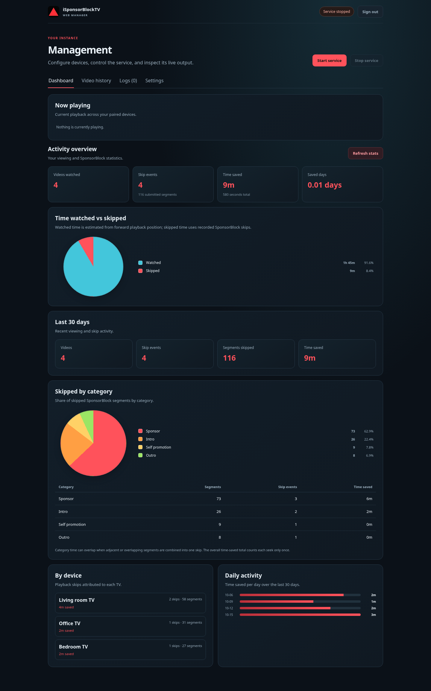

# iSponsorBlockTV Web

An authenticated web management interface that runs the upstream
[iSponsorBlockTV](https://github.com/dmunozv04/iSponsorBlockTV) service and
keeps its configuration and logs in one place. The upstream service remains
responsible for playback monitoring, SponsorBlock segment handling, ad muting
and skipping, and device communication.

## Dashboard preview



The screenshot uses sample activity to illustrate the statistics dashboard.

## Install with Docker Compose

### One-line install

On a Linux host with Docker Engine and the Docker Compose plugin installed and
running, run:

```sh
curl -fsSL https://raw.githubusercontent.com/BANAANGA/isponsorblocktv-web/main/install.sh | bash
```

The installer clones the app into
`~/.local/share/isponsorblocktv-web`, prompts you to create a username and
password, builds and starts the container, and keeps its configuration and logs
in a Docker volume. The password prompt is hidden; use 12-128 letters, numbers,
underscores, or hyphens. Then open `http://localhost:8000` and sign in.

To install into a different directory, set `ISPBTV_INSTALL_DIR` before running
the installer:

```sh
curl -fsSL https://raw.githubusercontent.com/BANAANGA/isponsorblocktv-web/main/install.sh \
  | ISPBTV_INSTALL_DIR="$HOME/apps/isponsorblocktv-web" bash
```

### Requirements and manual install

- Docker Engine with the Docker Compose plugin, running under your user.
- A computer or server that can reach the internet and, for automatic device
  discovery, the same local network as the TVs.

To install manually, run these commands from a terminal:

```sh
git clone https://github.com/BANAANGA/isponsorblocktv-web.git
cd isponsorblocktv-web
read -r -p "Username: " WEB_USERNAME
read -r -s -p "Password: " WEB_PASSWORD; printf '\n'
export WEB_USERNAME WEB_PASSWORD
docker compose up --build -d
```

The installer above is recommended: it validates the credentials and saves them
in a protected `.env` file so they persist across shell sessions and restarts.

Open `http://localhost:8000` on the host running Docker and sign in with the
credentials you configured. To sign in from another computer on the network,
use `http://<server-address>:8000`.

Compose stores the service configuration, logs, and generated session-signing
key in the persistent `isponsorblocktv-data` volume. Keep that volume when
updating or recreating the container. Back it up with your normal Docker volume
backup process.

If deploying behind an HTTPS reverse proxy, set `COOKIE_SECURE=true` in the
service's environment so the session cookie is only sent over HTTPS. Do not
expose the service to the public internet without HTTPS and a strong password.
For example, create a `.env` file next to `compose.yaml` and put your chosen
values in it:

```dotenv
WEB_USERNAME=admin
WEB_PASSWORD=replace-this-with-a-long-unique-password
COOKIE_SECURE=true
```

Restrict access to this file:

```sh
chmod 600 .env
```

Then start Compose with `docker compose up --build -d`; Compose loads `.env`
automatically.

### Install with Arcane

1. In Arcane, select the Docker environment where you want to run the service
   and create a new Compose stack.
2. Use the public Git repository
   `https://github.com/BANAANGA/isponsorblocktv-web`, branch `main`, and the
   repository's `compose.yaml`. If your Arcane setup does not deploy stacks
   from Git, paste the contents of `compose.yaml` into its Compose editor.
3. Add these stack environment variables, replacing the example username and
   password with your own strong credentials:

   ```dotenv
   WEB_USERNAME=admin
   WEB_PASSWORD=replace-this-with-a-long-unique-password
   COOKIE_SECURE=false
   ```

   Keep `COOKIE_SECURE=false` when accessing Arcane's published HTTP port
   directly. Set it to `true` when the web manager is accessed through an HTTPS
   reverse proxy.
4. Deploy the stack. Confirm that Arcane publishes container port `8000` on
   host port `8000` and retains the named `isponsorblocktv-data` volume across
   redeployments.
5. Open `http://<docker-host-address>:8000` and sign in with the credentials
   you configured. For automatic TV discovery, the container also needs access
   to your local network; pairing with a YouTube TV code works without it.

### Local-network device discovery

Automatic discovery uses DIAL and Chromecast and requires local-network access.
On Linux, Docker deployments that need discovery can use host networking:
remove the `ports` section from the service in `compose.yaml` and add
`network_mode: host`. The web interface will then be available at
`http://<server-address>:8000`. Pairing with a YouTube TV pairing code works
without host networking.

### Update, inspect, and stop

Rebuild and restart after pulling a new version:

```sh
git pull
docker compose up --build -d
```

Inspect container output or stop the service:

```sh
docker compose logs -f
docker compose down
```

`docker compose down` keeps the named data volume. Do not use
`docker compose down --volumes` unless you intend to delete configuration and
saved logs.

## Usage

1. Sign in to the web manager.
2. Add a TV device. Choose **Pair device** and enter the 12-digit code shown
   in the YouTube app's **Settings → Link with TV code**, or choose
   **Discover devices** when Docker has local-network access.
3. Review device names and skip offsets. Configure SponsorBlock categories,
   minimum segment length, ad muting/skipping, autoplay, and other options.
4. Optionally add a YouTube Data API key and whitelist channels. A key is
   required to search for channels and use the whitelist; custom channel IDs
   can also be entered directly.
5. Choose **Save settings**. The service starts automatically when a device
   is paired; use the service controls to start or stop it later.
6. Open **Logs** to inspect the upstream service output. Logs are retained in
   the data volume and rotated after the active log file reaches 5 MB.

## Features

- Single-admin sign-in with signed, HTTP-only session cookies, CSRF protection
  for changes, and login rate limiting.
- Pairing-code setup, optional local-network discovery, and management of
  multiple TV devices and per-device skip offsets.
- All upstream configuration options: SponsorBlock categories, minimum skip
  length, skip-count reporting, native ad mute/skip, autoplay, join name,
  YouTube channel whitelist and API key, proxy setting, and SponsorBlock API
  URL, plus upstream debug logging and HTTP tracing switches.
- Start/stop controls and a live-refreshing log viewer for the upstream
  service, with sortable timestamp, level, source, and message columns ordered
  newest first by default, log persistence, rotation, and a control to
  permanently delete saved logs.
- Video history with direct YouTube links and an estimated viewed percentage
  based on observed playback time and the duration reported by the TV device.
  The percentage is capped at 100%; unavailable durations are shown as such.
  History also includes statistics for watched videos,
  thumbnails, public video titles and channel names, skipped segments by
  category and device, skip events, and estimated time saved overall and over
  the last 30 days. The Dashboard tab is the first page shown after sign-in and
  includes a current playback widget with watched percentage and play/pause
  controls for videos already playing on paired devices,
  plus watched-versus-skipped and category pie charts, historical watched and
  skipped time graphs grouped by day, week, month, or year, and a most-watched
  videos graph.
- Configure the maximum number of retained video-history entries (100 to
  10,000); oldest entries are automatically removed. Delete viewing history
  and its related activity statistics from the Settings tab when needed.
- Turn off video-history recording in Settings to stop saving new per-video
  entries, metadata, and video IDs with skip events. Aggregate watched/skip
  statistics and current playback continue; previously recorded history remains
  until deleted.
- Dashboard activity-by-hour and activity-by-weekday graphs compare watched
  and skipped time, and identify each peak period. Choose the IANA time zone
  used by these breakdowns and video-history timestamps in Settings; choose
  12-hour or 24-hour time display there as well.
  Watched-time breakdowns start with this version because older totals were not
  timestamped precisely enough to convert.
- Dashboard time comparison estimates watched time from forward playback
  position changes and compares it with SponsorBlock skip durations. Older
  playback sessions are not backfilled.
- Activity is recorded from the time this version is installed; the upstream
  service does not provide older playback history to backfill. Video metadata
  is looked up using YouTube's public oEmbed endpoint.
- Persistent upstream configuration in `/data/config.json`, web-manager
  settings in `/data/webui-settings.json`, and activity in
  `/data/activity.sqlite3`.

The web manager is licensed under GPL-3.0 and uses the GPL-3.0 upstream
iSponsorBlockTV package. Upstream code is installed as a pinned dependency, not
copied into this repository.
